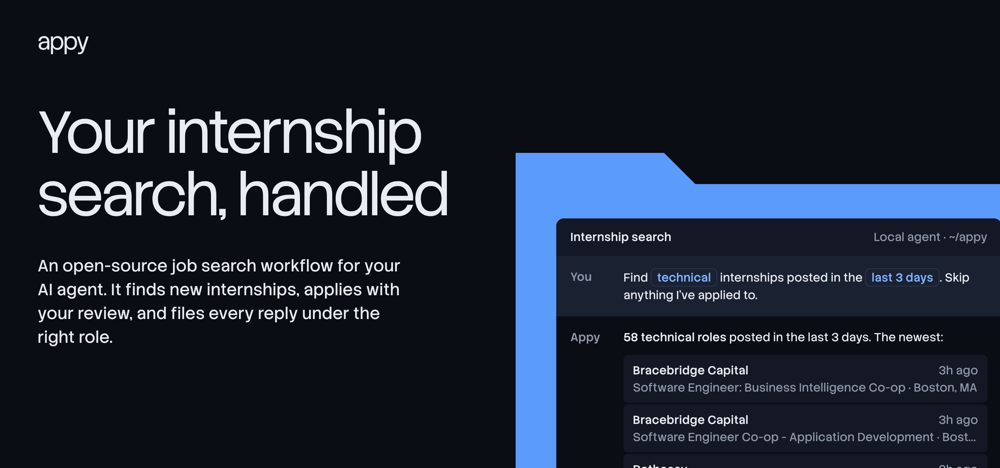
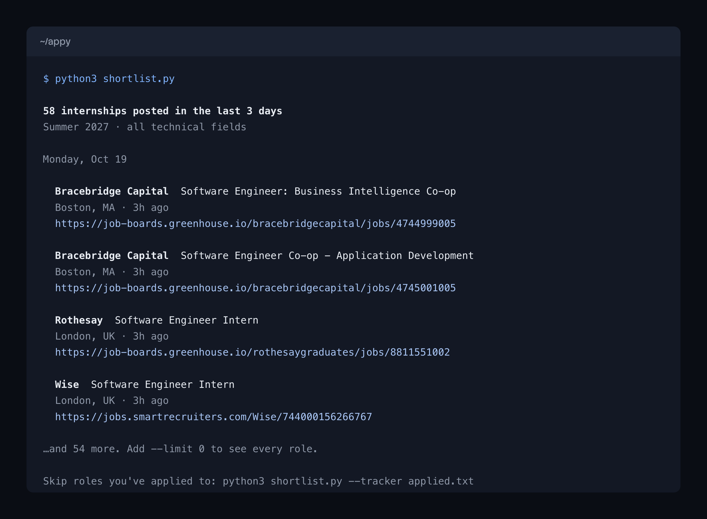
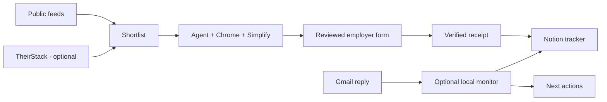

<p align="center">
  <a href="https://cole-godfrey.github.io/appy/"></a>
</p>

<p align="center">
  <a href="https://github.com/Cole-Godfrey/appy/actions/workflows/ci.yml"></a>
  <a href="LICENSE"></a>
  
</p>

Appy is an open-source job search workflow for your AI agent. It finds internships posted this week, fills applications with your review, and files every recruiter reply under the right role in Notion.

**[See this week's internships](https://cole-godfrey.github.io/appy/)** · [Setup guide](docs/setup.md) · [How it works](docs/architecture.md) · [Contribute](CONTRIBUTING.md)

## Get a shortlist in one command

Python 3.10+ only. No account, key or packages.

```sh
git clone https://github.com/Cole-Godfrey/appy.git
cd appy
python3 shortlist.py
```



```sh
python3 shortlist.py --field quant --days 7       # software, data, quant, hardware, product
python3 shortlist.py --where "New York, Remote"   # match locations
python3 shortlist.py --tracker applied.txt        # skip roles you applied to: one URL per line, or a Notion export
python3 shortlist.py --json                       # for scripts and agents
```

Listings come from the public [SimplifyJobs](https://github.com/SimplifyJobs/Summer2027-Internships) feed, filtered by Appy's discovery rules. Offline? `--sample` uses fictional listings.

## Let your agent apply

```sh
python3 setup_workspace.py
```

Then follow the [setup guide](docs/setup.md) to add your profile, connect Notion and Gmail, and configure Chrome with Simplify. Start with a shortlist or one reviewed application.

| Part | What it does | What you need |
| --- | --- | --- |
| Shortlist | Recent roles by field and place, minus ones you applied to | Python |
| Discovery | Adds Greenhouse and Ashby boards, career-fair companies, optional TheirStack | Python; a tracker export |
| Applications | Fills forms from your facts, verifies receipts, records submissions | Local agent with browser tools, Chrome, Notion; Gmail for codes |
| Email monitor | Matches incoming mail to the right tracker row and next step | macOS, Codex CLI, Gmail and Notion tools, Google Cloud |

Discovery targets summer internships in software, ML, data, quant, and related technical roles. The application rules work for other searches.

## From posting to reply



The agent follows [APPLICATION_GUIDE.md](APPLICATION_GUIDE.md). It uses documented facts, checks duplicates before applying, and records a submission after confirming the employer receipt. Your prompt sets whether it may submit.

## Your data

Personal working files, resumes, tokens, and tracker exports are ignored by Git. The public repo contains blank templates and fictional fixtures. AI providers and connected services still process the information you send them; read [data handling](docs/privacy.md) before connecting accounts.

## Development

```sh
python3 -m unittest discover -v
python3 scripts/check_public.py
```

Tests use mocks and local fixtures. The site in `site/` is static; a [scheduled workflow](.github/workflows/pages.yml) refreshes its listings every six hours. See [CONTRIBUTING.md](CONTRIBUTING.md) and [SECURITY.md](SECURITY.md).

| Documentation | |
| --- | --- |
| [Complete setup](docs/setup.md) | Profile, tools, first run, troubleshooting |
| [Notion tracker](docs/notion.md) | Schema, data source ID, complete exports |
| [Discovery reference](docs/discovery.md) | Sources, filters, costs, output |
| [Optional Gmail monitor](docs/gmail-monitor.md) | Cloud setup, OAuth, macOS service |
| [Example prompts](docs/prompts.md) | Shortlists, reviewed applications, email catch-up |
| [Launch plan](docs/launch-plan.md) | Channels, schedule, ready-to-edit posts |

Appy is independent of OpenAI, Notion, Google, SimplifyJobs, and Simplify. [MIT licensed](LICENSE).
