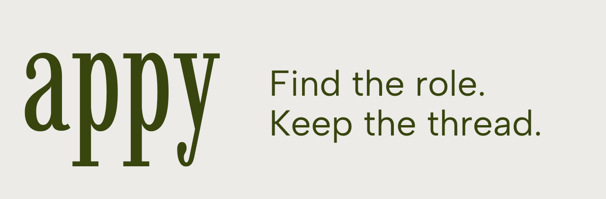
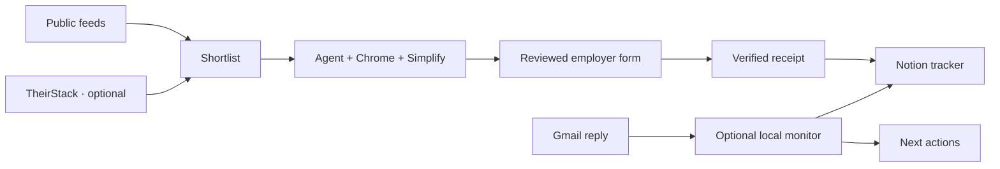

<p align="center">
  
</p>

<p align="center">
  <a href="https://github.com/Cole-Godfrey/appy/actions/workflows/ci.yml"></a>
  <a href="LICENSE"></a>
  
</p>

Appy is an open source job application workflow for a local AI agent. It finds internships, checks your application history, helps fill employer forms, and keeps recruiting replies tied to the right role in Notion.

[Setup guide](docs/setup.md) · [Try the demo](#try-it-offline) · [How it works](docs/architecture.md) · [Contribute](CONTRIBUTING.md)

## See it work


The demo uses fictional companies and the real deduplication code. It connects no accounts and submits no applications.

## Try it offline

You need Git and Python 3.10+. The demo has no package dependencies.

```sh
git clone https://github.com/Cole-Godfrey/appy.git
cd appy
python3 scripts/demo.py
```

It reads three sample listings, skips the role already in the sample tracker, and returns two candidates. Run `python3 scripts/demo.py --json` to inspect the data.

## Use it for your search

```sh
python3 setup_workspace.py
```

Then follow the [setup guide](docs/setup.md) to add your profile, connect Notion and Gmail, and configure Chrome with Simplify. Start with a shortlist or one reviewed application.

| Part | What it does | What you need |
| --- | --- | --- |
| Discovery | Searches public feeds, enriches Greenhouse and Ashby jobs, removes tracked roles | Python; TheirStack is optional |
| Applications | Uses your facts and Simplify to fill forms, verifies receipts, records submissions | Local agent with browser tools, Chrome, Notion; Gmail for codes |
| Email monitor | Detects incoming mail and runs an agent turn to update the matching tracker row | macOS, Codex CLI, Gmail and Notion tools, Google Cloud |

Discovery currently targets summer internships in software, ML, data, quant, and related technical roles. The application instructions can be adapted to other searches. This is a collection of scripts and agent workflows; setup includes connecting your own services.

## From posting to reply



The agent follows [APPLICATION_GUIDE.md](APPLICATION_GUIDE.md). It uses documented facts, checks duplicates before applying, and records a submission after confirming the employer receipt. Your prompt sets whether it may submit.

## Your data

Personal working files, resumes, tokens, and tracker exports are ignored by Git. The public repo contains blank templates and fictional fixtures. AI providers and connected services still process the information you send them; read [data handling](docs/privacy.md) before connecting accounts.

## Development

```sh
python3 -m unittest discover -v
python3 scripts/check_public.py
```

Tests use mocks and local fixtures. See [CONTRIBUTING.md](CONTRIBUTING.md) for development and [SECURITY.md](SECURITY.md) for private reports.

| Documentation | |
| --- | --- |
| [Complete setup](docs/setup.md) | Profile, tools, first run, troubleshooting |
| [Notion tracker](docs/notion.md) | Schema, data source ID, complete exports |
| [Discovery reference](docs/discovery.md) | Sources, filters, costs, output |
| [Optional Gmail monitor](docs/gmail-monitor.md) | Cloud setup, OAuth, macOS service |
| [Example prompts](docs/prompts.md) | Shortlists, reviewed applications, email catch-up |
| [Launch plan](docs/launch-plan.md) | Channels, schedule, ready-to-edit posts |

Appy is independent of OpenAI, Notion, Google, and Simplify. [MIT licensed](LICENSE).
