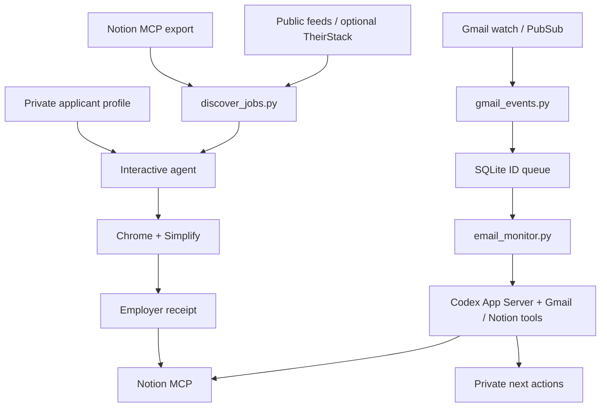

# Architecture

Appy combines deterministic Python scripts with instructions for a local agent. It has no hosted backend or central applicant database.

| File | Responsibility |
| --- | --- |
| `shortlist.py` | Readable recent roles from the public feed; feeds the site's board |
| `discover_jobs.py` | Source queries, enrichment, normalization, deduplication, freshness |
| `appy_config.py` | Non-executing local setting reads; tracker ID validation |
| `setup_workspace.py` | Creates private working files without overwriting them |
| `gmail_monitor_setup.py` | Desktop OAuth consent and private runtime configuration |
| `gmail_events.py` | Watch renewal, history pagination, StreamingPull, notification recovery |
| `email_monitor.py` | App Server RPC, durable queue, processing turns, retry rules |
| `monitor_service.py` | macOS LaunchAgent lifecycle |
| `APPLICATION_GUIDE.md` | Applicant facts, browser review, submission receipts, tracker rules |
| `EMAIL_MONITOR.md` | Evidence matching, stage changes, next actions |
| `site/` | Static website; the Pages workflow writes `roles.json` from `shortlist.py` |

Discovery is read-only apart from output and optional API credit usage. Browser submissions require the user's scoped authorization. The monitor's instructions restrict it to recruiting evidence and next actions; those are agent instructions, not a sandbox that proves every model action safe.

Queue/cursor updates commit together after complete history reads. Notifications are acknowledged after that commit, so a failed page can be redelivered. Message IDs deduplicate arrivals. Processing failures remain pending until a new arrival releases a retry batch.

The Python test suite covers these boundaries with mocks. Live forms, external feed availability, OAuth consent, and connector compatibility require checking with your own accounts. Discovery works on Python 3.10+; the service requires macOS and the connector contracts described in setup.
